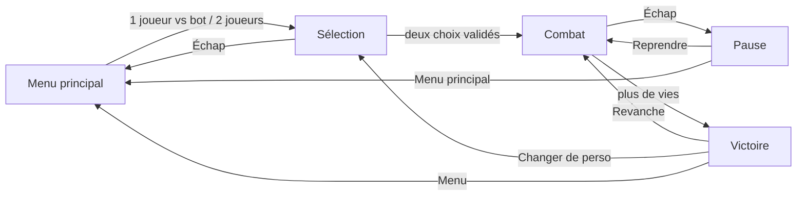

# Écrans

[Sommaire](../README.md) · Précédent : [Personnages](03-personnages.md) · Suivant : [Architecture](../technique/01-architecture.md)

Derrière tous les menus, l'arène vit (nuages, particules d'éco, conduits des pylônes) sous un voile
sombre qui garde le texte lisible. Les plateformes flottantes y sont masquées pour ne jamais couper
le logo, un bouton ou le vainqueur.

## Menu principal

Logo, accroche, trois boutons (« 1 JOUEUR VS BOT », « 2 JOUEURS », « QUITTER »). En bas, un
bandeau sombre rappelle les commandes : une ligne par joueur, puis l'astuce partagée (traverser une
plateforme, pause) en plus discret.

## Sélection

- Une rangée de six portraits. Chaque curseur porte son étiquette (1P rouge, 2P bleu, BOT gris).
  Si les deux curseurs sont sur le même portrait, le second est décalé pour rester visible.
- Un panneau par joueur : aperçu animé du personnage, nom dans sa couleur, titre, trois jauges
  (vitesse, puissance, poids), nom et description du spécial, et l'état (« CHOIX EN COURS »,
  « PRÊT ! », « EN ATTENTE... », « J1 CHOISIT LE BOT »).
- En bas, les touches utiles pour choisir, valider et annuler.

## Combat

- **Compte à rebours** : 3, 2, 1, « COMBAT ! ». Les combattants ne répondent qu'après.
- **Marqueur de joueur** : une étiquette 1P / 2P / BOT flotte au-dessus de chaque combattant, dans la
  couleur du joueur. C'est ce qui permet de se reconnaître dans un miroir (même personnage des deux
  côtés).
- **Ombre au sol** : projetée sur la surface sous le combattant (sol ou plateforme), elle rétrécit
  quand il monte. Elle aide à viser les atterrissages.
- **HUD** : deux cartes compactes en bas de l'écran, bien séparées. Chacune montre la tête du
  personnage, « 1P · KAEL », le pourcentage de dégâts et un point par vie restante. Le pourcentage
  passe du blanc à l'orange puis au rouge à mesure qu'il approche 150 %, et grossit brièvement à
  chaque coup reçu.
- **Retours d'impact** :
  - la cible flashe en blanc chaud ;
  - une étincelle apparaît au point d'impact ;
  - le jeu se fige un court instant (hit-stop), proportionnel aux dégâts ;
  - l'écran tremble.
- **Mouvement** : saut, double saut et atterrissage soulèvent de la poussière.
- **KO** : un éclat dans la couleur du personnage éclate au bord de l'écran, là où il est sorti,
  avec un fort tremblement.
- **Fin** : « FIN DU COMBAT ! », ralenti pendant deux secondes, puis l'écran de victoire.

## Pause

Voile sombre par-dessus le combat figé, titre « PAUSE », boutons « REPRENDRE » et
« MENU PRINCIPAL ». Échap ouvre et ferme la pause.

## Victoire

« VICTOIRE ! », le personnage vainqueur animé, « JOUEUR 1 GAGNE AVEC KAEL », la durée du match,
puis « REVANCHE », « CHANGER DE PERSO » et « MENU ».

## Textes

Tous les textes affichés sont en majuscules, dans la police pixel EcoPixel, et regroupés à un seul
endroit (`src/ui/ui_text.gd`). Un test vérifie que la police sait dessiner chacun de leurs
caractères (voir [Tests](../technique/08-tests.md)).
