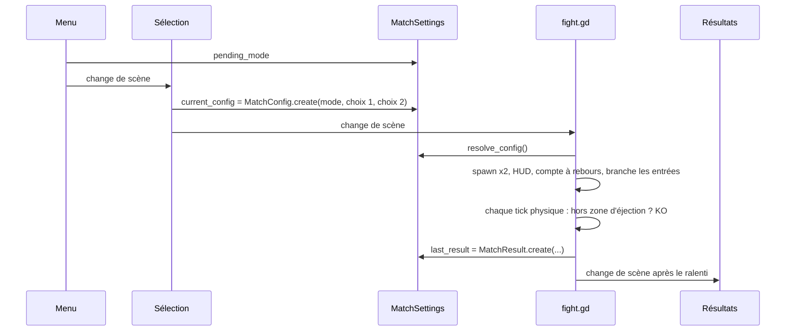

# Architecture

[Sommaire](../README.md) · Précédent : [Écrans](../fonctionnel/04-ecrans.md) · Suivant : [Le combattant](02-combattant.md)

## Pile technique

| Élément | Choix |
|---|---|
| Moteur | Godot 4.7, rendu GL Compatibility |
| Langage du jeu | GDScript typé |
| Résolution | 480 x 270, étirement `canvas_items`, fenêtre 1440 x 810 (x3) |
| Rendu pixel | filtre `nearest`, transformations 2D alignées sur le pixel |
| Assets | générés une fois par un outil Python + Pillow, versionnés en PNG |
| Tests | runner GDScript maison, exécuté en headless |

## Arborescence

```
assets/          PNG générés, police EcoPixel (.fnt), thème UI, layout.json, animated_layers.json
data/fighters/   Les 6 personnages (.tres) : statistiques, coups, sprites
scenes/          fighter, stage, fight, ui/(main_menu, character_select, results)
src/core/        Entrées : InputFrame, InputSource (port), clavier, Null Object, schémas de touches
src/bot/         IA : perception, cerveau (pur), source d'entrée bot
src/combat/      AttackData, formule de knockback, HitVolume, CombatResolver
src/fighters/    Fighter, définitions, roster, coups (MeleeStrike, ProjectileShot), sprite frames
src/match/       MatchConfig, MatchResult, autoload MatchSettings, fabrique d'entrées, scène de combat
src/stage/       Arène : sol, plateformes, spawns, zone d'éjection, couches animées
src/fx/          Effets ponctuels, flash d'impact (shader), caméra qui tremble, découpe de strips
src/ui/          Textes, kit UI, menus, HUD, pause, résultats
tests/           Runner headless et suites
tools/assets/    Générateur d'assets Python (one-shot)
docs/            Cette documentation
```

## Scènes

| Scène | Racine | Rôle |
|---|---|---|
| `scenes/ui/main_menu.tscn` | `Control` | Scène de départ (`run/main_scene`). |
| `scenes/ui/character_select.tscn` | `Control` | Choix des deux personnages. |
| `scenes/fight.tscn` | `Node2D` + `src/match/fight.gd` | Le match : arène, monde, résolveur, caméra, HUD, pause. |
| `scenes/ui/results.tscn` | `Control` | Écran de victoire. |
| `scenes/stage.tscn` | `Node2D` + `Stage` | L'arène, réutilisée en fond de chaque menu. |
| `scenes/fighter.tscn` | `CharacterBody2D` + `Fighter` | Un combattant : ombre, sprite, marqueur, corps, volumes. |

Les chemins des scènes sont centralisés dans `src/ui/scene_paths.gd`.

Arbre de `fight.tscn` :

```
Fight (fight.gd)
├── Stage            l'arène
├── World            combattants, projectiles, effets
├── CombatResolver   qui touche qui
├── Camera           ShakeCamera
├── Hud              cartes, compte à rebours, bannière
└── PauseMenu        process_mode = ALWAYS
```

## Autoloads

| Nom | Script | Rôle |
|---|---|---|
| `InputBindings` | `src/core/input_bindings.gd` | Enregistre toutes les actions clavier dans l'`InputMap` avant toute lecture. |
| `MatchSettings` | `src/match/match_settings.gd` | Porte entre les scènes le mode choisi, la config du prochain match et le dernier résultat. |

## Couches physiques

| Couche | Nom | Qui l'occupe |
|---|---|---|
| 1 | `fighters` | Les combattants. |
| 2 | `ground` | Le sol de l'arène. |
| 3 | `platforms` | Les trois plateformes traversables (collision à sens unique). |

Un combattant détecte les couches 2 et 3. Pour traverser une plateforme, il retire la couche 3 de
son masque pendant 0,25 s (`Fighter.PLATFORM_LAYER`). Un test vérifie que les plateformes de
l'arène sont bien sur cette couche.

## Déroulé d'un match



## Principes de conception

Le code suit quelques règles constantes. Elles expliquent la forme de la plupart des classes.

- **Une responsabilité par classe.** Le `Fighter` ne décide pas qui touche qui : il crée des volumes
  de coup et reçoit des coups ; seul `CombatResolver` croise les deux.
- **Ports et implémentations.**
  - `InputSource` est le port entre un combattant et ce qui le pilote. Clavier et bot l'implémentent.
  - `NullInputSource` est un Null Object : un combattant sans contrôleur reste immobile, ce qui
    évite tout `null`.
- **Strategy.** `FighterMove` décide de l'effet d'un coup (`MeleeStrike`, `ProjectileShot`) ;
  ajouter un type de coup, c'est ajouter une classe.
- **Une seule source par information.**
  - Les indices d'animation viennent de `layout.json`, la place des couches animées de
    `animated_layers.json` : les deux sont écrits par le générateur Python et lus par Godot.
  - Les textes viennent de `UiText`, les couleurs de joueur de `palette.py`, et la clé de slot de
    `MatchConfig.resolve_slot_tag`.
- **Données plutôt que code.** Un personnage est une ressource `.tres` éditable dans l'inspecteur.
- **Des noms qui disent l'action.** Toute méthode commence par un verbe : `compute_`, `format_`,
  `resolve_`, `create_`, `find_`, `is_` / `has_` / `can_`.
