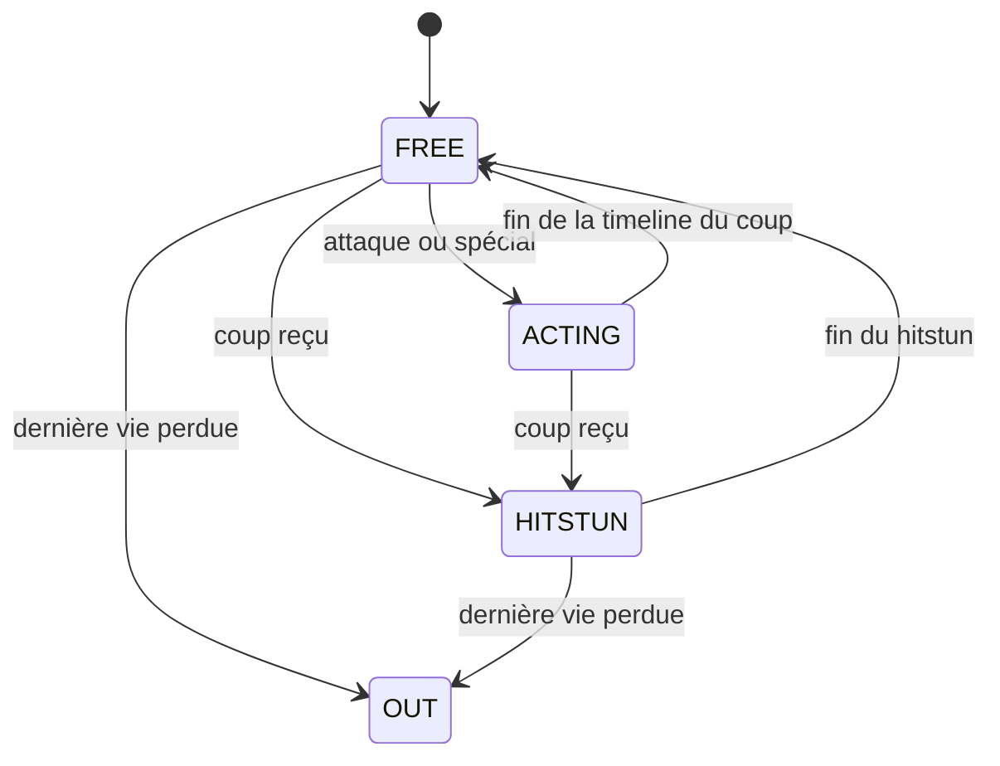

# Le combattant

[Sommaire](../README.md) · Précédent : [Architecture](01-architecture.md) · Suivant : [Combat](03-combat.md)

Un combattant, c'est trois choses séparées :

- **les données** : `FighterDefinition` (`.tres`) ;
- **le comportement** : `Fighter` (`src/fighters/fighter.gd`) ;
- **le pilote** : un `InputSource`.

Le combattant ne sait jamais si un humain ou un bot le contrôle.

## Données : `FighterDefinition`

`src/fighters/fighter_definition.gd`, une ressource par personnage dans `data/fighters/`.

| Champ | Rôle |
|---|---|
| `id`, `display_name`, `title` | Identité. `id` sert aussi de nom de fichier pour les sprites. |
| `accent_color` | Couleur du nom et des vies dans le HUD, teinte de l'éclat de KO. |
| `sprite_sheet`, `portrait`, `stock_icon` | Images générées (planche d'animation, portrait 48 px, tête 16 px du HUD). |
| `body_size` | Taille de la zone touchable (et de la collision), ancrée aux pieds. |
| `run_speed`, `jump_velocity`, `air_jumps`, `weight` | Déplacement et résistance aux projections. |
| `light_attack`, `special` | Deux `FighterMove`. |

Les jauges de l'écran de sélection sont calculées, jamais saisies :

```
note = clamp(1 + arrondi(ratio * 4), 1, 5)
ratio = position de la valeur dans son intervalle
  vitesse   : run_speed dans [90, 170]
  puissance : dégâts attaque + dégâts spécial dans [10, 24]
  poids     : weight dans [70, 140]
```

Le `FighterRoster` (`src/fighters/fighter_roster.gd`) liste les six définitions dans l'ordre du menu.

## Entrées : `InputFrame` et `InputSource`

Un `InputFrame` est l'intention d'un tick physique, identique quelle que soit sa source :

| Champ | Sens |
|---|---|
| `move_x` | Direction horizontale, de -1 à 1. |
| `down` | Bas maintenu (chute rapide, traverser une plateforme). |
| `jump_pressed`, `attack_pressed`, `special_pressed` | Appuis du tick (front montant). |

`InputSource` est une classe abstraite à une méthode, `read_frame()`. Implémentations :

| Classe | Pilote |
|---|---|
| `KeyboardInputSource` | Lit les actions d'un `ControlScheme` (joueur 1 ou 2). |
| `BotInputSource` | Demande une décision au `BotBrain` (voir [IA](04-ia.md)). |
| `NullInputSource` | Ne fait rien : compte à rebours, fin de match. |

`ControlScheme` (`src/core/control_scheme.gd`) associe à chaque joueur des **touches physiques**
(donc ZQSD en AZERTY et WASD en QWERTY) et crée les actions `p1_left`, `p1_attack`, `p2_up`, etc.
`format_key_label` affiche la touche telle que le clavier de l'utilisateur la nomme.
`InputSourceFactory` choisit clavier ou bot pour chaque slot selon le `MatchConfig`.

## Machine à états



| État | Ce qui se passe |
|---|---|
| `FREE` | Course, sauts, chute rapide, traverser une plateforme, lancer un coup. |
| `ACTING` | Un coup se déroule ; la vitesse au sol freine. L'effet du coup part à la fin du démarrage. |
| `HITSTUN` | Projeté, sans contrôle ; la vitesse horizontale freine doucement. |
| `OUT` | Plus de vies : caché, plus traité. |

## Un tick physique

Ordre dans `Fighter._physics_process` :

1. Si `OUT`, rien.
2. Lire l'`InputFrame` de la source.
3. Décompter les minuteurs (invulnérabilité, flash d'impact, traversée de plateforme).
4. Mettre à jour l'état courant.
5. Appliquer la gravité, puis `move_and_slide()`.
6. Si le combattant vient de toucher le sol : recharger sauts et spécial aérien, poussière si la
   chute était rapide.
7. Mettre à jour le visuel (animation, retournement, clignotement, flash) et l'ombre.

## Constantes de mouvement

Dans `fighter.gd`, en pixels et secondes :

| Constante | Valeur | Sens |
|---|---|---|
| `GRAVITY` | 980 | Gravité. |
| `MAX_FALL_SPEED` / `FAST_FALL_SPEED` | 380 / 560 | Vitesse de chute max, normale et rapide (bas en l'air). |
| `GROUND_ACCELERATION` / `GROUND_FRICTION` | 1500 / 1700 | Accélérer et freiner au sol. |
| `AIR_ACCELERATION` | 950 | Contrôle en l'air. |
| `AIR_JUMP_RATIO` | 0,9 | Hauteur d'un saut en l'air par rapport au saut au sol. |
| `DROP_THROUGH_DURATION` | 0,25 | Durée pendant laquelle les plateformes sont ignorées. |
| `RESPAWN_INVULNERABILITY` | 2 | Invulnérabilité après réapparition. |

Une projection plus rapide que la vitesse de chute max n'est jamais ralentie par la gravité.

## Coups : `FighterMove`

`FighterMove` est une Strategy : la timeline du coup est gérée par le `Fighter`, le coup ne
décide que de son effet, dans `trigger_effect(user)`, appelé à la fin du démarrage.

| Classe | Effet |
|---|---|
| `MeleeStrike` | Applique un élan (`lunge`, x relatif à l'orientation) puis crée un volume de coup attaché au combattant. |
| `ProjectileShot` | Crée un volume de coup qui voyage (`speed`, `lifetime`) avec sa propre animation. |

Chaque coup porte un `AttackData` (dégâts, projection, hitbox, timeline) : voir [Combat](03-combat.md).

## Sprites

Chaque planche fait 64 px de haut, une image de 64 x 64 par pose. `FighterSpriteFrames` lit
`assets/fighters/layout.json`, écrit par le générateur, pour savoir quelles images forment chaque
animation (`idle`, `run`, `jump`, `fall`, `attack`, `special`, `hurt`), à quelle vitesse et si elle
boucle. Le même fichier donne la ligne des pieds (`feet_y`) : le sprite est décalé pour que les
pieds dessinés tombent exactement sur l'origine du corps.

Pendant un coup, l'image affichée suit la phase (démarrage, actif, récupération), pas le temps.

## Éléments visuels attachés

| Nœud | Rôle |
|---|---|
| `Shadow` | Ombre au sol : un rayon vers le bas avec le masque du combattant ; 3 tailles selon la hauteur (`compute_shadow_frame`). |
| `Sprite` | L'animation, avec le shader de flash d'impact. |
| `Marker` | L'étiquette 1P / 2P / BOT, posée au-dessus de `body_size`. |
| `Volumes` | Les volumes de coup au corps à corps en cours. |

Détails dans [Arène et effets](05-arene-et-effets.md).
