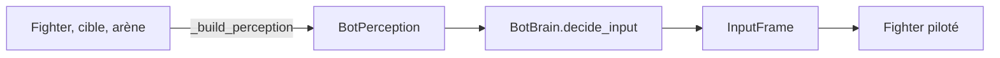

# IA

[Sommaire](../README.md) · Précédent : [Combat](03-combat.md) · Suivant : [Arène et effets](05-arene-et-effets.md)

Le bot est un `InputSource` comme un joueur humain : le combattant qu'il pilote ne fait aucune
différence. Il est découpé en trois classes pour que la décision soit testable sans scène.

## `BotPerception`

`src/bot/bot_perception.gd` : un instantané de données simples, sans référence à la scène.

| Champ | Sens |
|---|---|
| `self_position`, `self_velocity` | Position et vitesse du bot. |
| `self_on_floor`, `self_has_air_jump` | Au sol ? Un saut en l'air disponible ? |
| `target_position`, `target_in_play` | Où est l'adversaire, est-il encore en jeu ? |
| `ground` | Rectangle de la surface du sol, lu sur la forme de collision de l'arène. |

## `BotBrain`

`src/bot/bot_brain.gd`, logique pure (un `RandomNumberGenerator` injecté rend les tests
déterministes). Deux priorités :

**1. Revenir sur l'arène.** S'il est hors du sol (à gauche, à droite, ou plus de 8 px sous la
surface), le bot se dirige vers le centre et utilise son saut en l'air dès qu'il tombe.

**2. Attaquer.**

- Il s'approche de la cible. Arrivé à portée, il ne fait plus que se tourner vers elle.
- Il refuse de marcher dans le vide depuis le sol.
- Si la cible est à portée (36 px) et à sa hauteur (32 px), il attaque avec une probabilité
  `aggression` (0,55 par défaut).
- Si elle est à moyenne distance (40 à 140 px) et à sa hauteur, il lance son spécial avec une
  probabilité `special_chance` (0,1).
- Si la cible est plus haut et proche, il saute. Si elle est plus bas et qu'il est sur une
  plateforme, il la traverse (bas + saut).

Les seuils sont des constantes en tête de fichier (`ATTACK_RANGE`, `VERTICAL_REACH`,
`JUMP_CHASE_RANGE`, `SPECIAL_MIN_RANGE`, `SPECIAL_MAX_RANGE`, `EDGE_MARGIN`...). Ils ont été
agrandis quand les sprites sont passés à 64 px.

## `BotInputSource`

`src/bot/bot_input_source.gd`. Le bot réfléchit **tous les 6 ticks**, comme un temps de réaction
humain. Entre deux décisions, les directions restent maintenues et les boutons ne sont pas répétés
(un appui ne vaut qu'une fois).

## Tests

`tests/unit/test_bot_brain.gd` vérifie qu'il poursuit une cible lointaine, frappe une cible à
portée, revient vers l'arène quand il en est sorti et refuse de tomber du bord.
