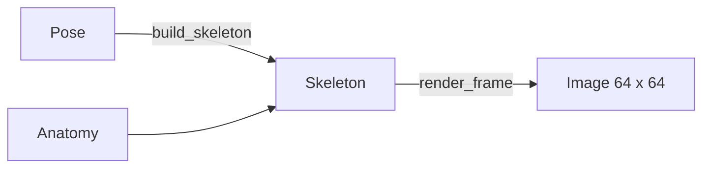

# Pipeline d'assets

[Sommaire](../README.md) · Précédent : [Interface](06-interface.md) · Suivant : [Tests](08-tests.md)

Tout ce qui s'affiche (sprites, décor, effets, UI, police, icône) est **dessiné par du code Python**
dans `tools/assets/`, une fois, puis versionné en PNG. Le jeu ne génère jamais d'image à l'exécution.

## Régénérer

Depuis la racine du dépôt (Python 3 et Pillow requis) :

```bash
python3 tools/assets/generate_assets.py
```

`generate_all(assets, icon_path)` peut écrire ailleurs que dans le dépôt : c'est ce que fait le test
`tools/tests/test_generated_assets.py`, qui compare la sortie du générateur aux PNG versionnés et
échoue si l'un des deux a changé sans l'autre.

Puis laisser Godot importer les nouveaux fichiers (création des `.import`) :

```bash
godot --headless --path . --import
```

Pour vérifier un PNG à l'œil, `preview.py` l'agrandit sans lissage :

```bash
python3 tools/assets/preview.py assets/fighters/kael.png /tmp/kael_x6.png 6
```

## Modules

| Fichier | Produit |
|---|---|
| `pixel.py` | Primitives sur pixels entiers : `Canvas`, rectangles, ellipses, polygones, dégradé tramé, contour, voile (`tint_toward`). |
| `palette.py` | Toutes les couleurs : flux (vert, bleu, rouge, jaune, sombre, orange), métal ancien, ciel, mer de nuages, couleurs de joueur. |
| `fighters.py` | Planches des 6 personnages et `layout.json`. |
| `stage.py` | Couches du décor, couches animées et `animated_layers.json`, effets (étincelle, orbes, ombre, poussière, éclat de KO). |
| `ui.py` | Logo, panneaux, portraits, têtes de HUD, curseurs, marqueurs de joueur. |
| `font.py` | Police EcoPixel (atlas PNG + descripteur AngelCode `.fnt`). |
| `generate_assets.py` | Point d'entrée : appelle tout et écrit dans `assets/`. |

## Fichiers produits

| Dossier | Contenu |
|---|---|
| `assets/fighters/` | `<id>.png` (une planche par personnage, images de 64 px), `layout.json`. |
| `assets/stage/` | `sky`, `clouds`, `far`, `mid`, `island`, `platform`, `pylon_glow`, `flux_motes`, `animated_layers.json`. |
| `assets/fx/` | `hit_spark`, `flux_bolt` (jaune), `flux_bolt_dark` (sombre), `shadow`, `dust`, `ko_burst`. |
| `assets/ui/` | `logo`, `panel`, `button*`, `portrait_<id>`, `stock_<id>`, `selector_<slot>`, `marker_<slot>`. |
| `assets/fonts/` | `eco_pixel.png`, `eco_pixel.fnt`. |
| `icon.png` | Portrait de Kael agrandi. |

## Les fichiers JSON partagés

Python et Godot lisent la même vérité, jamais recopiée à la main :

- `layout.json` : taille des images, ligne des pieds, et pour chaque animation ses indices d'image,
  sa cadence et si elle boucle ;
- `animated_layers.json` : planche, largeur d'image, cadence et position de chaque couche animée de
  l'arène.

## Dessiner un personnage

`fighters.py` repose sur une **marionnette** et le patron Template Method :

- `FighterArtist` fixe le squelette, la cinématique inverse et l'ordre de dessin ;
- chaque sous-classe (`KaelArtist`, `PipArtist`, `GrondakArtist`, `OrmosArtist`, `VargoArtist`,
  `KraggArtist`) ne peint que son torse, sa tête, ses habits et ses accessoires.



- **Pose** : décalages d'une image, en pixels à l'échelle de Kael. Les pieds sont donnés par
  rapport à la hanche, les mains par rapport à l'épaule. S'y ajoutent `bob` (montée ou descente du
  corps), `lean` (inclinaison), `hurt` (yeux en croix) et un effet (`SMEAR`, `CHARGE`, `RELEASE`,
  `FOLLOW`).
- **Anatomy** : longueurs et épaisseurs (jambe, torse, épaules, tête, bras), et `reach`, l'échelle
  appliquée aux poses (0,65 pour Pip, 1,15 pour Grondak).
- **Cinématique inverse** : `solve_joint` place genoux et coudes entre l'épaule ou la hanche et la
  main ou le pied. Les genoux pointent vers l'avant, les coudes vers l'arrière ; une main hors de
  portée est ramenée au bout du bras.
- **Membres** : `fill_limb` dessine un segment effilé (quadrilatère + articulation arrondie).

Ordre de dessin d'une image :

1. accessoires arrière (écharpe, queue, bâton, dossier du fauteuil) ;
2. bras arrière, jambe arrière ;
3. torse et jambe avant (ou l'inverse quand une robe couvre les jambes) ;
4. tête, bras avant, accessoires avant (canon, fauteuil) ;
5. contour ;
6. effets par-dessus.

Les animations communes sont définies une fois (`IDLE`, `RUN`, `JUMP`, `FALL`, `ATTACK`, `HURT`) ;
seul le spécial a des poses propres à chaque personnage.

## Règles de dessin

- Pixels entiers uniquement : aucun agrandissement non entier à l'exécution. L'ombre, par exemple,
  a trois tailles dessinées plutôt qu'une échelle.
- Jamais de noir pur pour les ombres : elles prennent la couleur du contour (`palette.OUTLINE`).
- Le décor garde peu de teintes ; le flux cyan est sa seule lumière. Les couleurs vives vont aux
  personnages.
- Un effet ne doit jamais déborder sur l'image voisine d'une planche (les rayons de l'éclat de KO
  sont bornés pour ça).
